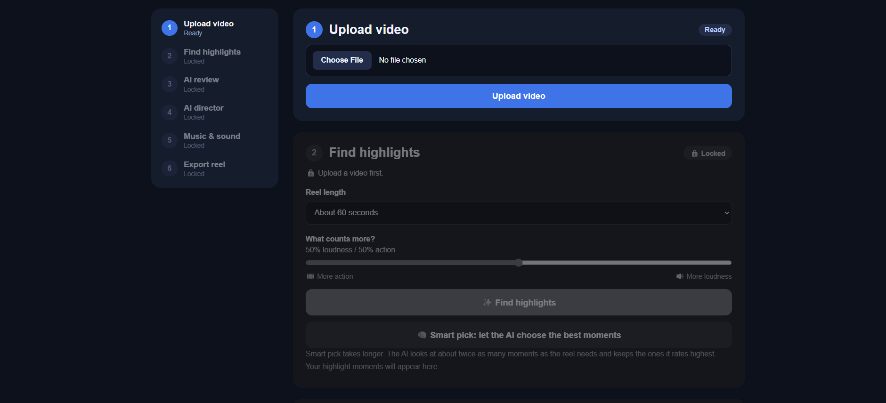

# 🎬 Highlight Generator

Turn a long video into a short highlight reel, privately, on your own computer.

Upload footage from a party, trip, college fest or wedding. The app finds the best moments, a local AI model reviews them, and your reel is cut and mixed with music. Nothing is uploaded to any server, and nothing costs money per video.



Built for the Hacktoberfest Open-Source AI Challenge, Week 2: Side Hustle.

## How it works

1. **Find.** FFmpeg and some simple maths score every second of the video by loudness and motion, then pick the strongest 6-second moments.
2. **Review.** A local vision model (Gemma 3 4B, through Ollama) looks at one frame from each moment, writes a short caption and rates how exciting it is. *Smart pick* uses these ratings to choose better moments.
3. **Direct.** The same model acts as a director. It chooses effects, transitions, a music mood and a sound mode, but only from fixed menus. The server checks every answer and falls back to safe defaults.
4. **Export.** FFmpeg cuts the clips, evens out their volume, joins them with transitions, mixes in music and renders an MP4.

The AI is the director and FFmpeg is the crew: the model never writes FFmpeg commands.

## What you need

- [Node.js](https://nodejs.org/) (a recent version)
- [FFmpeg](https://ffmpeg.org/) with `ffprobe`, as a full build (on Windows: `winget install Gyan.FFmpeg`)
- [Ollama](https://ollama.com/) with the Gemma 3 4B model

## Run it

```bash
# 1. Get the model (one time)
ollama pull gemma3:4b

# 2. Install the packages (one time)
npm install

# 3. Create the 10 built-in music tracks (one time, takes a few minutes)
node make-music.js

# 4. Start the app
node server.js
```

Then open <http://localhost:3000>.

If `ollama list` shows a different name for Gemma, change `VISION_MODEL` near the top of `server.js` to match. Any vision-capable model that Ollama can run should work.

## Music

The 10 built-in tracks are composed by `make-music.js` from scratch, so nobody owns them and they are safe to use in reels you share or sell. You can also upload your own tracks in the app. Only upload music you have the right to use.

## Limits

- The AI sees one frame per moment and cannot hear, so its sound suggestion is a guess.
- Gemma 3 4B ratings are rough, and a low rating can be wrong.
- The built-in music is simple synthesized loops, not studio quality.
- It is a local, single-user tool: no accounts, no hosting.
- Analysis and review results are kept in memory and reset when the server restarts.
- The `uploads/` and `outputs/` folders grow until you clear them.

## Footage

Only use footage you own or have permission to use.

## License

MIT. See [LICENSE](LICENSE).